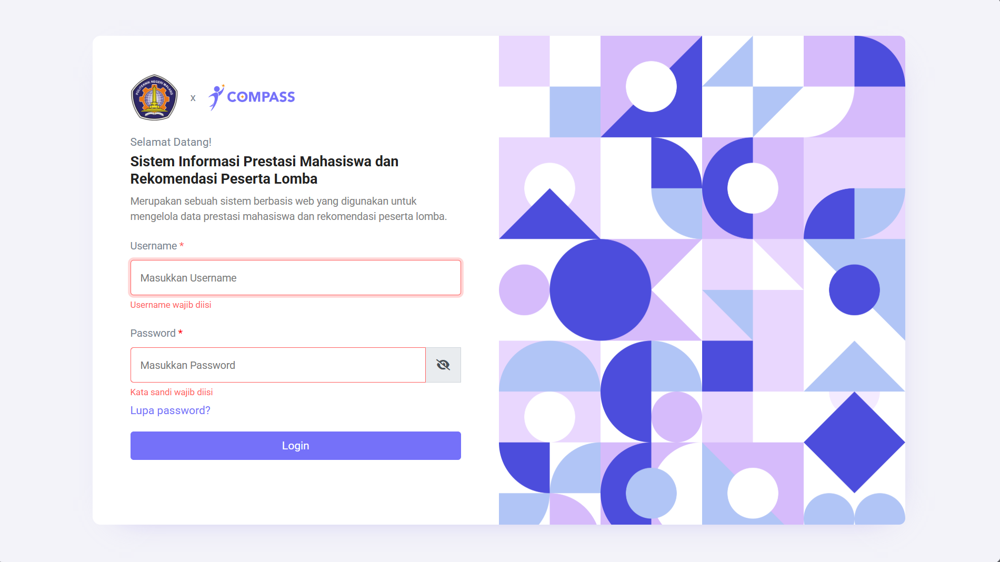
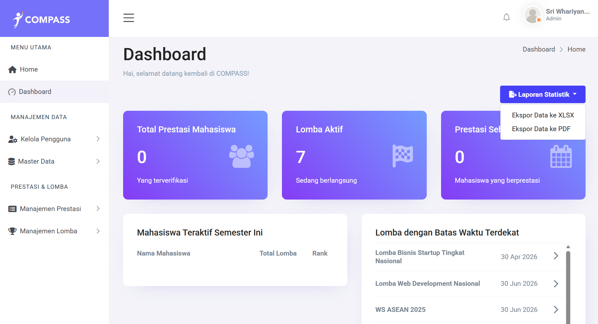
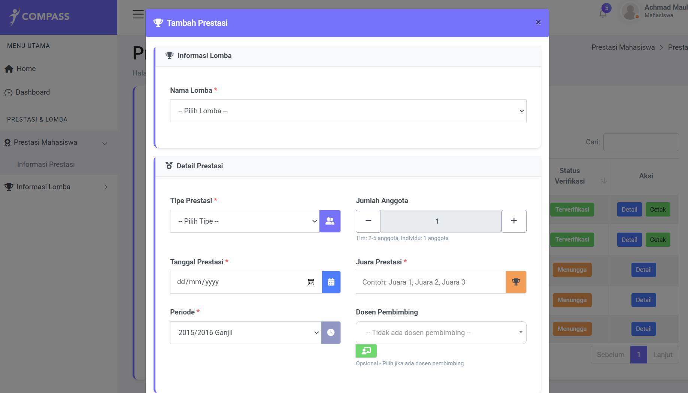
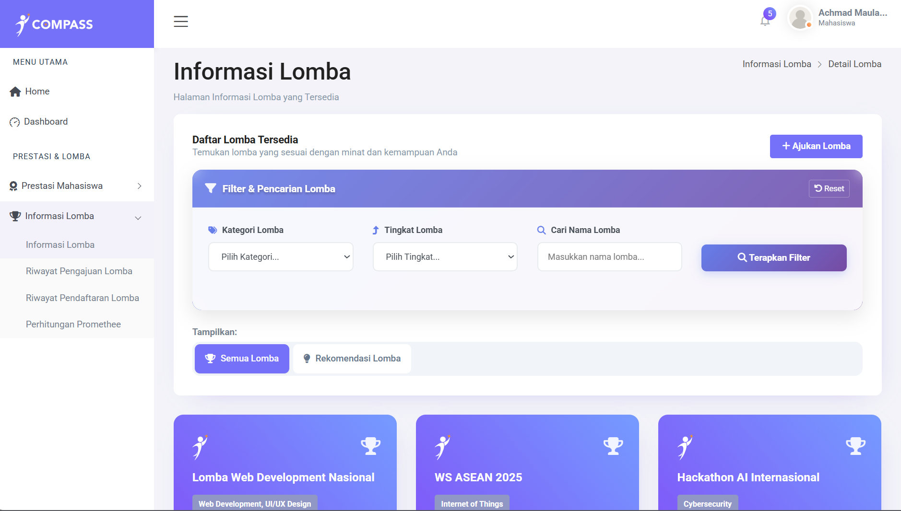

# COMPASS - Panduan Setup Lokal (Testing Projek Kuliah)

Dokumen ini adalah panduan lengkap untuk menjalankan aplikasi COMPASS di lingkungan lokal (development/testing), mulai dari setup environment, database, migration, seeding, sampai aplikasi bisa diakses di browser.

Catatan: panduan ini ditujukan untuk kebutuhan tugas/projek kuliah dan uji coba lokal, bukan panduan deployment production.

## 1. Prasyarat

Pastikan perangkat sudah memiliki:

- PHP 8.1 atau lebih baru
- Composer 2.x
- MySQL 8.x atau MariaDB kompatibel
- Node.js 18.x atau lebih baru
- NPM 9.x atau lebih baru
- Git (opsional, jika clone repository)
- Laragon (direkomendasikan untuk Windows)

Cek versi di terminal:

```bat
php --version
composer --version
mysql --version
node --version
npm --version
```

Panduan pengguna lengkap: [User Manual Book](https://docs.google.com/document/d/1y5qPIlUtFjfvfMxdHHp3P4I6KEErOMhOHc22SLmvpx8/edit?usp=sharing)

## 2. Ambil Project dan Masuk Folder

Jika project sudah ada lokal, langsung masuk ke folder. Jika belum, clone dulu.

```bat
cd /d D:\path\to\webroot
git clone <url-repository-anda> COMPASS
cd COMPASS
```

Jika folder sudah ada:

```bat
cd /d D:\path\to\COMPASS
```

## 3. Install Dependency

Install dependency backend (PHP/Laravel) dan frontend (Vite):

```bat
composer install
npm install
```

## 4. Konfigurasi Environment

### 4.1 Buat file .env

```bat
copy .env.example .env
```

### 4.2 Generate APP_KEY

```bat
php artisan key:generate
```

### 4.3 Atur konfigurasi database di .env

Edit file `.env` lalu sesuaikan bagian ini:

```env
APP_NAME=COMPASS
APP_ENV=local
APP_DEBUG=true
APP_URL=http://localhost:8000

DB_CONNECTION=mysql
DB_HOST=127.0.0.1
DB_PORT=3306
DB_DATABASE=compass
DB_USERNAME=root
DB_PASSWORD=
```

Jika pakai virtual host Laragon (misalnya `compass.test` atau `compass.local`), ubah `APP_URL` sesuai domain tersebut.

## 5. Setup Database Utama (Migration + Seeder)

Ini alur utama yang direkomendasikan.

### 5.1 Buat database kosong

Buat database baru di MySQL, contoh nama: `compass`.

Contoh via MySQL CLI:

```sql
CREATE DATABASE compass CHARACTER SET utf8mb4 COLLATE utf8mb4_unicode_ci;
```

### 5.2 Jalankan migration

```bat
php artisan migrate
```

### 5.3 Jalankan seeder

```bat
php artisan db:seed
```

Seeder utama dipanggil dari [database/seeders/DatabaseSeeder.php](database/seeders/DatabaseSeeder.php).

### 5.4 Kredensial awal hasil seeding

Berdasarkan [database/seeders/UserSeeder.php](database/seeders/UserSeeder.php#L382), password user dibuat dari username:

- `password = username`

Contoh:

- Username: `123456789101112134`
- Password: `123456789101112134`

Penting: setelah login pertama, user wajib mengganti password untuk keamanan.

## 6. Opsi Database Alternatif (Import SQL Dump)

Jika tersedia file backup `.sql`, Anda bisa import tanpa migration.

Contoh:

```bat
mysql -u root -p compass < backup_compass.sql
```

Catatan:

- Jangan jalankan migration ulang jika dump sudah berisi struktur tabel final, kecuali memang dibutuhkan.
- Gunakan salah satu alur: migration+seeder atau import dump.
- Jika tidak punya file dump resmi, gunakan alur migration + seeder.

## 7. Reset Database Untuk Development Harian

Jika ingin reset total data saat development:

```bat
php artisan migrate:fresh --seed
```

Perintah ini akan:

- drop semua tabel
- membuat ulang tabel dari migration
- mengisi ulang data awal dari seeder

## 8. Setup Storage dan File Upload

Agar file di `storage/app/public` bisa diakses browser, buat symlink:

```bat
php artisan storage:link
```

Path penting file upload:

- Foto profil: `storage/app/public/img/profile/`
- Gambar lomba: `storage/app/public/img/lomba/`
- Berkas prestasi: `storage/app/public/prestasi/`
- Bukti pendaftaran (sebagian fitur): `public/uploads/bukti/`

## 9. Jalankan Aplikasi

Ada 2 cara umum.

### 9.1 Opsi A - Laravel Artisan

Terminal VS Code:

```bat
php artisan serve --host=127.0.0.1 --port=8000
```

Alternatif jika ingin akses dari perangkat lain di jaringan yang sama:

```bat
php artisan serve --host=0.0.0.0 --port=8000
```

Akses aplikasi di:

- `http://127.0.0.1:8000`

### 9.2 Opsi B - Laragon Virtual Host

Jika project ada di folder web root Laragon, jalankan web server dari Laragon lalu akses domain virtual host Anda.

Contoh:

- `http://compass.test`
- atau `http://compass.local`

Untuk kebutuhan coba jalan di lokal, cukup gunakan `npm run dev`.

## 10. Workflow Penggunaan Awal

Setelah web berjalan, alur validasi awal:

1. Buka halaman login.
2. Login memakai akun seeder (username dan password sama).
3. Pastikan redirect sesuai role (Admin, Dosen, Mahasiswa).
4. Coba akses menu utama sesuai role.
5. Uji upload file gambar sederhana (misal foto profil).
6. Pastikan file tersimpan dan bisa dibuka dari browser.

### Halaman Login


### Dashboard Admin


### Form Upload Prestasi


### Rekomendasi Lomba


## 11. Checklist Verifikasi Setup End-to-End

Jalankan checklist ini dari atas ke bawah:

```bat
cd /d D:\path\to\COMPASS

composer install
npm install
copy .env.example .env
php artisan key:generate

php artisan migrate
php artisan db:seed

php artisan storage:link
php artisan config:clear
php artisan cache:clear
```

Setelah langkah di atas, jalankan aplikasi mengikuti [Bagian 9](#9-jalankan-aplikasi).

Validasi akhir:

1. Halaman login terbuka.
2. Login berhasil dengan akun seeder.
3. Dashboard sesuai role tampil normal.
4. Upload file/gambar berhasil.
5. Data tersimpan di database.

## 12. Troubleshooting

### 12.1 Error koneksi database

Periksa ulang `.env`:

- `DB_HOST`
- `DB_PORT`
- `DB_DATABASE`
- `DB_USERNAME`
- `DB_PASSWORD`

Lalu jalankan:

```bat
php artisan config:clear
```

### 12.2 Error APP_KEY missing

```bat
php artisan key:generate
```

### 12.3 Gambar/file tidak tampil

```bat
php artisan storage:link
```

Pastikan symlink `public/storage` sudah terbentuk.

### 12.4 Class tidak ditemukan / autoload bermasalah

```bat
composer dump-autoload
```

### 12.5 Asset frontend tidak termuat

Jalankan salah satu:

```bat
npm run dev
```

atau

```bat
npm run build
```

Untuk konteks testing projek kuliah, umumnya cukup `npm run dev`.

### 12.6 Opsional: izin folder storage/cache (jika permission error)

```bat
icacls "D:\path\to\COMPASS\storage" /grant:r "%USERNAME%:F" /t
icacls "D:\path\to\COMPASS\bootstrap\cache" /grant:r "%USERNAME%:F" /t
```

---

Jika semua langkah di atas sukses, aplikasi COMPASS sudah siap digunakan dari alur database sampai web berjalan penuh.
